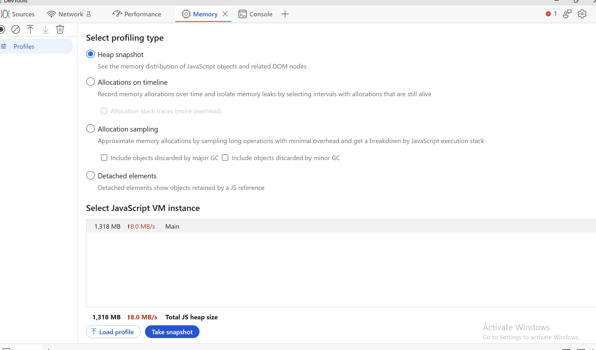
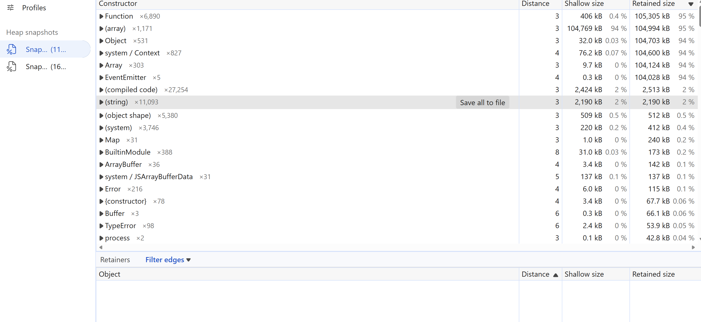
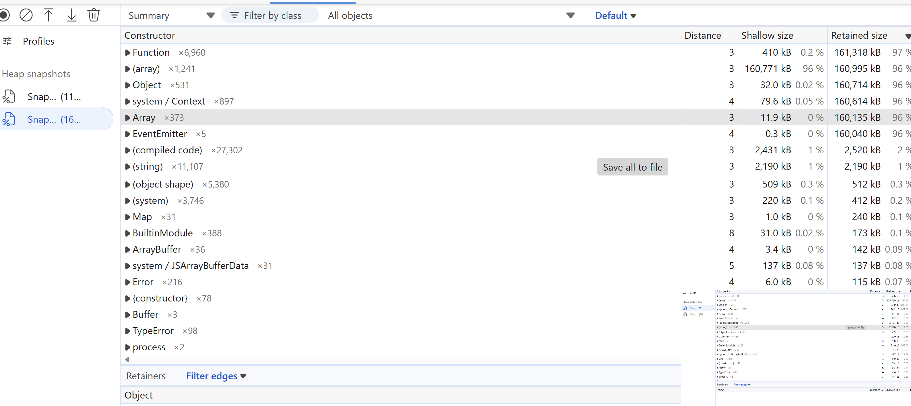
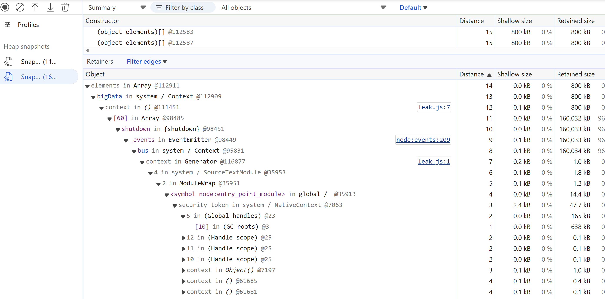

# Day 9: Memory leak via closure

## The bug

`leak.js` adds an event listener to a long-lived `EventEmitter` on every request and never removes it.
The listener is a closure that captures `bigData` (~0.8 MB), so that memory can never be freed.

## Evidence

Terminal: listeners and heap grow without limit (~7.5 MB/s), and Node warns about it:

```
listeners: 10, heap: 11 MB
MaxListenersExceededWarning: Possible EventEmitter memory leak detected. 11 shutdown listeners added
listeners: 340, heap: 264 MB
```

DevTools shows the heap growing at 8 MB/s:



Two heap snapshots ~7 seconds apart: +70 arrays, +70 functions, +70 closure contexts (70 leaked requests):




The retainer chain shows exactly what keeps the memory alive:

`bigData → closure context → listener (leak.js:7) → _events.shutdown → bus → global`



## The fix

`handler.js` names the listener and removes it with `bus.off()` when the request finishes,
which breaks the chain so the garbage collector can free `bigData`.

## Test

`handler.test.js` runs 100 requests and checks that no listeners remain:
fails before the fix (`100 !== 0`), passes after.
